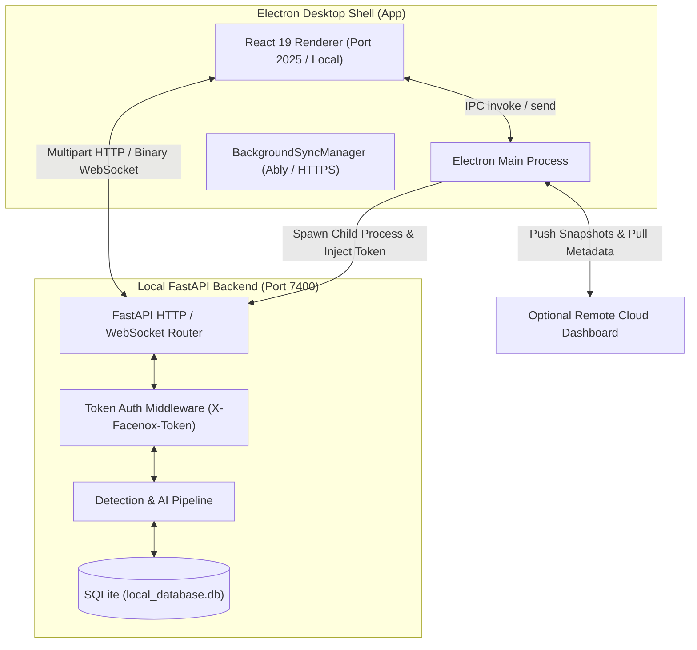
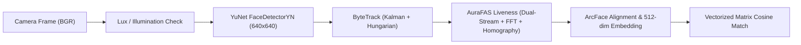

# Reverse Engineering Analysis: Facenox (Offline-First Face Recognition Attendance System)

> **Dokumen Analisis Reverse Engineering Mendalam**  
> **Target Analisis**: `templates/facenox-main`  
> **Tanggal**: 15 Oktober 2026  
> **Status**: Selesai / Komprehensif  
> **Tujuan**: Membedah seluruh arsitektur, pipeline kecerdasan buatan (Computer Vision & Anti-Spoofing), manajemen biometrik end-to-end (E2EE), sistem basis data offline-first, desain UI/UX kiosk, serta strategi adopsi terbaik ke dalam ekosistem `absensi-cam`.

---

## Daftar Isi
1. [Ringkasan Eksekutif & Karakteristik Utama](#1-ringkasan-eksekutif--karakteristik-utama)
2. [Arsitektur Sistem & Struktur Monorepo](#2-arsitektur-sistem--struktur-monorepo)
3. [Deep-Dive: Computer Vision & AI Pipeline](#3-deep-dive-computer-vision--ai-pipeline)
   - 3.1 Deteksi Wajah (YuNet / FaceDetectorYN)
   - 3.2 Multi-Subject Tracking (ByteTrack)
   - 3.3 Anti-Spoofing & Liveness: AuraFAS (Dual-Stream + FFT + Homography Parallax)
   - 3.4 Rekognisi & Embedding Wajah (ArcFace / MobileFaceNet)
   - 3.5 Adaptive Frame Skipping & Optimasi Inferensi ONNX
4. [Logika Bisnis Absensi & Time Authority](#4-logika-bisnis-absensi--time-authority)
   - 4.1 Mekanisme Cooldown Anti-Duplikasi
   - 4.2 Agregasi Sesi, Keterlambatan, dan Aturan Berlakunya Grup
   - 4.3 Mitigasi Clock Drift Hardware (TimeAuthorityService)
5. [Keamanan, Kriptografi & Privasi Biometrik](#5-keamanan-kriptografi--privasi-biometrik)
   - 5.1 Enkripsi Data Lokal (DPAPI, Keychain, Linux Keyring)
   - 5.2 Arsip Backup Terenkripsi (.facenox)
   - 5.3 Komunikasi IPC / HTTP Terproteksi Token Dinamis
   - 5.4 End-to-End Encryption (E2EE) untuk Cloud Sync
6. [Arsitektur Frontend (Electron + React 19)](#6-arsitektur-frontend-electron--react-19)
   - 6.1 Rendering Overlay HTML5 Canvas Berkualitas Tinggi
   - 6.2 State Machine Panduan Visual Real-Time
7. [Matriks Komparasi: Facenox vs Absensi-Cam](#7-matriks-komparasi-facenox-vs-absensi-cam)
8. [Rekomendasi Strategis & Komponen yang Layak Diadopsi](#8-rekomendasi-strategis--komponen-yang-layak-diadopsi)

---

## 1. Ringkasan Eksekutif & Karakteristik Utama

**Facenox** adalah aplikasi absensi biometrik wajah desktop *offline-first* yang dirancang dengan prinsip privasi tinggi (*privacy by design*). Berbeda dengan sistem absensi komersial berbasis cloud yang mengirimkan frame mentah atau foto wajah siswa/pegawai ke server remote, Facenox mengeksekusi 100% inferensi AI secara lokal pada CPU standar komputer/kiosk tanpa memerlukan GPU dedicated (NVIDIA/CUDA).

### Karakteristik Kunci:
1. **Zero Raw Photo Persistence**: Frame mentah kamera diproses langsung dalam memori (RAM) dan tidak pernah disimpan ke disk ataupun diunggah ke jaringan.
2. **CPU-Optimized Inference**: Memanfaatkan model-model ultra-ringan ONNX (YuNet 120 KB, AuraFAS 4.9 MB, ArcFace 7.1 MB) dengan thread berurutan yang stabil untuk mencegah thermal throttling dan UI freeze.
3. **AuraFAS Dual-Stream + 3D Parallax Active Challenge**: Menggabungkan spectral analysis (FFT 2D), dual contextual crops, dan perhitungan matematis *Homography Residual Error* untuk membedakan perputaran kepala manusia 3D asli dari foto/layar digital 2D datar secara matematis.
4. **Offline Resilience**: Basis data SQLite lokal menyimpan seluruh data absensi, anggota, dan vektor biometrik terenkripsi. Konektivitas internet hanya bersifat opsional saat sinkronisasi ke Facenox Management Dashboard.

---

## 2. Arsitektur Sistem & Struktur Monorepo

Facenox diorganisasi sebagai **pnpm workspace** yang memisahkan aplikasi desktop frontend dan server inferensi AI lokal:

```text
templates/facenox-main/
├── package.json               # Root workspace konfigurasi pnpm
├── app/                       # Frontend Desktop (Electron v42 + React 19 + TypeScript + Vite)
│   ├── electron.vite.config.ts
│   ├── electron-builder.json  # Multi-platform installer (NSIS .exe, DMG, AppImage, .deb)
│   └── src/
│       ├── electron/          # Main Process: Lifecycle, Child Process Manager, Sync, Auto-updater
│       │   ├── backend/       # BackendProcessManager (manajemen child process Python)
│       │   ├── managers/      # BackgroundSyncManager, EmbeddingCrypto
│       │   └── main.ts
│       └── components/        # React Renderer: Kiosk UI, Canvas Overlays, Modals, Settings
│           └── main/          # Core Scanning Interface (VideoCanvas, DetectionPanel)
└── server/                    # Local AI Backend (Python 3.10+ / FastAPI)
    ├── main.py                # Entry point API, validasi token keamanan X-Facenox-Token
    ├── run.py                 # Dev runner
    ├── build_backend.py       # Script PyInstaller pembungkus binary mandiri
    ├── core/
    │   ├── cipher.py          # Kriptografi AES-256-GCM, DPAPI, PBKDF2
    │   ├── lifespan.py        # Pemuatan paralel model-model ONNX saat startup
    │   └── models/            # Implementasi Computer Vision
    │       ├── face_detector/     # YuNet FaceDetectorYN
    │       ├── tracker/           # ByteTrack multi-object tracking + Kalman filter
    │       ├── liveness_detector/ # AuraFAS (Passive Dual-Stream + Active Controller)
    │       └── face_recognizer/   # ArcFace feature extraction + Cosine matching
    ├── database/              # SQLite, SQLAlchemy (AsyncIO), Alembic
    ├── api/routes/            # REST API & WebSocket Streaming
    └── services/              # AttendanceService, TimeAuthorityService, LiveStreamService
```

### Pola Interaksi Komponen


---

## 3. Deep-Dive: Computer Vision & AI Pipeline

Pipeline inferensi Facenox terdiri dari 4 tahapan sekuensial yang sangat terkoordinasi:



### 3.1 Deteksi Wajah (YuNet / FaceDetectorYN)
- **Model**: `detector.onnx` (122 KB).
- **Resolusi Input**: Dinamis atau di-scale ke `640 x 640`.
- **Ambang Batas**:
  - `score_threshold`: 0.8
  - `nms_threshold`: 0.3
  - `top_k`: 5000
  - `min_face_size`: 80 piksel
- **Dynamic Low-Light Preprocessing**:
  Sebelum melakukan inferensi, Facenox menghitung rata-rata kecerahan warna (*lux*) pada **70% ROI tengah** (`center 70%`) untuk mengabaikan pantulan lampu plafon atau silau jendela. Jika berada dalam kondisi redup, saluran luma (Y pada YCrCb) diberikan kompensasi kontras gamma secara dinamis.

### 3.2 Multi-Subject Tracking (ByteTrack)
Facenox mengimplementasikan **ByteTrack** lengkap (`tracker.py`, `byte_tracker.py`, `kalman_filter.py`) dengan Hungarian algorithm (`lap` solver):
- Setiap wajah yang terdeteksi diberikan `track_id` persisten.
- Menggunakan **Kalman Filter** 8-dimensi `[x, y, a, h, vx, vy, va, vh]` untuk memprediksi posisi kotak pembatas pada frame berikutnya.
- Menghitung asosiasi bounding box menggunakan **Intersection over Union (IoU)**.
- **Keunggulan Arsitektural**: Ketika wajah seseorang sudah terverifikasi (liveness lolos & identitas dikenali), rekognisi berat tidak perlu dijalankan ulang pada setiap frame berikutnya! Kotak tracking cukup mengunci status pengenalan (*face lock*) selama `track_id` tetap valid.

### 3.3 Anti-Spoofing & Liveness: AuraFAS
AuraFAS menggabungkan tiga pilar pertahanan anti-spoofing tingkat enterprise:

#### A. Dual-Stream Crop + 2D FFT Frequency Analysis (Pasif)
1. **Tight Face Crop**: Bounding box wajah dengan rasio 1.0 diubah ukurannya ke `256 x 256` piksel.
2. **Context Face Crop**: Wajah dengan rasio 2.0x (memasukkan area leher, telinga, dan latar belakang sekitar) untuk memeriksa apakah tepi layar ponsel/kertas terlihat.
3. **2D Fast Fourier Transform (FFT)**:
   ```python
   dft = np.fft.fft2(gray_img)
   dft_shift = np.fft.fftshift(dft)
   magnitude = np.log(np.abs(dft_shift) + 1.0)
   ```
   Layar smartphone/monitor memancarkan kisi piksel (*pixel grid*) dan artefak refresh rate yang menghasilkan puncak spektrum frekuensi tinggi unik pada domain Fourier. FFT 2D dikompresi ke matriks `16 x 16` dan dimasukkan langsung sebagai input tensor ketiga ke model ONNX liveness (`liveness.onnx`, 4.9 MB).
4. **Logit Margin Classification**:
   - Model mengeluarkan output 2 logit: `[real_logit, spoof_logit]`.
   - `logit_diff = real_logit - spoof_logit`.
   - Lolos jika `logit_diff >= 2.197` (setara probabilitas sigmoid $\ge 90\%$).
   - Terkonfirmasi spoof jika `logit_diff < 0.0`.

#### B. Active Challenge: 3D Homography Residual & Volumetric Parallax (Aktif)
Ini adalah inovasi matematika paling brilian di Facenox:
- Saat pengguna diminta menoleh secara perlahan (`Slowly turn head`), sistem mencatat koordinat 5 titik landmark awal (`pts_base`) dan landmark saat ini (`pts_curr`).
- Menghitung matriks transformasi perspektif bidang datar 2D (*Homography Matrix* $H$):
  ```python
  H, _ = cv2.findHomography(pts_base, pts_curr, method=0)
  ```
- **Kelemahan Serangan 2D (Foto/Layar HP)**: Jika sebuah foto atau tablet diputar di depan kamera, seluruh titik landmark berada di satu bidang datar (planar surface), sehingga residual error dari homografi mendekati nol (**Strain < 1.00%**).
- **Karakteristik Wajah 3D Manusia Asli**: Hidung manusia menonjol keluar dari bidang mata (memiliki kedalaman optik / *depth parallax*). Saat kepala berputar, hidung mengalami pergeseran non-planar terhadap sumbu mata.
  - Facenox menghitung **Volumetric Parallax Invariance (VPI)** dan **Strain %**.
  - Jika `Strain < 1.00%` saat menoleh $\rightarrow$ **REJECT: Planar Spoof Terdeteksi**!
  - Liveness hanya diverifikasi valid jika `Strain >= 1.90%` dan `VPI >= 4.5` secara stabil selama 3 frame berturut-turut!

#### C. Temporal Smoothing (TrackLivenessMemory)
Mengharuskan wajah memiliki status `real` minimal 3 frame berturut-turut (`required_real_frames: 3`) agar tidak terjadi kedipan salah deteksi (*flickering*).

### 3.4 Rekognisi & Embedding Wajah (ArcFace / MobileFaceNet)
- **Model**: `recognizer.onnx` (7.17 MB).
- **Penyelarasan Wajah (Affine Alignment)**:
  5 landmark (`mata kiri`, `mata kanan`, `hidung`, `sudut bibir kiri`, `sudut bibir kanan`) disejajarkan ke titik referensi kanonikal 112x112 menggunakan transformasi kesamaan:
  ```python
  tform, _ = cv2.estimateAffinePartial2D(landmarks, REFERENCE_POINTS, method=cv2.LMEDS)
  aligned_face = cv2.warpAffine(image, tform, (112, 112), flags=cv2.INTER_LINEAR)
  ```
- **Normalisasi**: `(RGB - 127.5) / 127.5` dalam format `[3, 112, 112]`.
- **Output**: Vektor embedding 512-dimensi yang dinormalisasi $L_2$ (`np.linalg.norm = 1.0`).
- **Pencarian Cepat Berbasis Matriks**:
  Seluruh vektor biometrik yang terdaftar disimpan dalam cache RAM sebagai matriks NumPy `(N, 512)`.
  Pencarian kesamaan kosinus dieksekusi secara instan dengan perkalian titik matriks:
  $$\text{similarities} = \mathbf{query\_vector} \cdot \mathbf{DB\_Matrix}^T$$
  Pencarian terhadap 500 identitas membutuhkan waktu **< 15 milidetik**.
- **Threshold**: Nilai kemiripan $\ge 0.45$ dianggap cocok (*match*).

### 3.5 Adaptive Frame Skipping & Optimasi Inferensi ONNX
- **Thread Control**: `inter_op_num_threads: 1` dan `intra_op_num_threads: 1` pada ONNX Runtime. Menghindari perebutan CPU core (*cache thrashing*) dan menjaga beban CPU tetap rendah dan stabil.
- **Adaptive Frame Skipping**:
  Endpoint deteksi mengembalikan header `suggested_skip`:
  - Jika waktu komputasi $> 50\text{ ms} \rightarrow$ Frontend melompati 2 frame (`skip 2`).
  - Jika waktu komputasi $> 30\text{ ms} \rightarrow$ Frontend melompati 1 frame (`skip 1`).
  - Mencegah penumpukan antrean gambar (*backpressure buffer*) pada browser/webcam.

---

## 4. Logika Bisnis Absensi & Time Authority

### 4.1 Mekanisme Cooldown Anti-Duplikasi
Untuk mencegah seorang siswa atau pegawai tercatat puluhan kali saat berdiri di depan kamera:
1. **Attendance Cooldown**: Default 300 detik (5 menit). Wajah yang sama tidak akan dicatat ulang selama durasi ini.
2. **Relog Anti-Duplicate Window**: Default 1800 detik (30 menit).
3. **Persistent UI Cooldown**: Electron renderer menampilkan animasi melingkar pada kartu deteksi wajah yang menunjukkan sisa waktu cooldown dalam detik/menit.

### 4.2 Agregasi Sesi, Keterlambatan, dan Aturan Berlakunya Grup
Facenox memisahkan catatan mentah (`attendance_records`) dari ringkasan harian (`attendance_sessions`):
- `attendance_records`: Menyimpan seluruh log timestamp fisik setiap kali wajah dikenali.
- `attendance_sessions`: Rekap harian per siswa/pegawai:
  - `check_in_time`: Log pertama pada tanggal tersebut ($\min(\text{timestamp})$).
  - `check_out_time`: Log terakhir pada tanggal tersebut ($\max(\text{timestamp})$) jika opsi `track_checkout` diaktifkan dan terdapat $> 1$ log.
  - `total_hours`: Durasi jam kehadiran.
  - `is_late` & `late_minutes`: Dihitung berdasarkan `class_start_time` dan `late_threshold_minutes`.
- **Effective-Dated Rules (`AttendanceGroupRule`)**:
  Jika admin mengubah jam masuk sekolah/kantor di tengah hari, perubahan tersebut memiliki metadata `effective_from`, sehingga absensi siswa yang masuk pagi hari tidak mendadak salah dihitung terlambat secara retrospektif.

### 4.3 Mitigasi Clock Drift Hardware (TimeAuthorityService)
Unit kiosk absensi offline rentan mengalami pergeseran waktu sistem operasi (karena baterai CMOS mati atau tidak ada sinkronisasi NTP):
- `TimeAuthorityService` melacak monotonic clock (`time.monotonic()`) sejak boot untuk memvalidasi apakah waktu sistem operasi dimundurkan secara manual oleh teknisi yang berniat curang.
- Menyediakan probe latensi rendah ke server referensi waktu (`google.com/generate_204`, `cloudflare.com/cdn-cgi/trace`) saat online untuk mencatat deviasi waktu (*drift seconds*) dan memberikan peringatan pada database jika drift $> 60\text{ detik}$.

---

## 5. Keamanan, Kriptografi & Privasi Biometrik

### 5.1 Enkripsi Data Lokal (Machine Key Storage)
Template biometrik wajah di basis data SQLite lokal tidak disimpan sebagai binary mentah, melainkan dienkripsi dengan **AES-256-GCM**:
- **Kunci Mesin (Machine Key)**:
  - **Windows**: Menggunakan **Windows DPAPI** (`CryptProtectData` / `CryptUnprotectData`). Kunci hanya dapat didekripsi oleh akun pengguna Windows yang sama pada komputer fisik tersebut.
  - **macOS**: Disimpan di macOS Keychain melalui perintah CLI `security`.
  - **Linux**: Mengakses Gnome Keyring / KWallet via D-Bus Secret Service. Jika headless, menggunakan berkas fallback dengan hak akses ketat `0600`.

### 5.2 Arsip Backup Terenkripsi (.facenox)
File backup diekspor dalam format binary mandiri berstruktur:
```text
[MAGIC: 8 bytes ("FACENOX\x00\x01")] 
[SALT: 16 bytes] 
[IV: 12 bytes] 
[CIPHERTEXT + AUTH_TAG: variable length]
```
- Derivasi Kunci: **PBKDF2-HMAC-SHA256** dengan **480.000 iterasi**.
- Cipher: **AES-256-GCM** (menjamin kerahasiaan dan integritas data terhadap modifikasi).

### 5.3 Komunikasi IPC / HTTP Terproteksi Token Dinamis
Agar aplikasi pihak ketiga atau situs web yang dibuka di peramban lokal tidak dapat mengakses port API lokal (Port 7400):
- Saat Electron menjalankan subprocess backend Python, ia menghasilkan token acak 32-byte kriptografis aman (`crypto.randomBytes(32).toString('hex')`) dan menginjeksikannya melalui variabel lingkungan `FACENOX_API_TOKEN`.
- Seluruh permintaan HTTP dan WebSocket dari frontend wajib menyertakan header `X-Facenox-Token`.
- Middleware FastAPI memvalidasi token menggunakan perbandingan waktu konstan `hmac.compare_digest()` untuk mencegah *timing attack*.

### 5.4 End-to-End Encryption (E2EE) untuk Cloud Sync
Saat fitur sinkronisasi cloud diaktifkan:
- Vektor embedding 512-dimensi dienkripsi pada Electron Main Process sebelum keluar dari perangkat (`EmbeddingCrypto.ts`):
  $$\text{Payload} = \text{IV}_{\text{base64}} \mathbin{\Vert} \text{TAG}_{\text{base64}} \mathbin{\Vert} \text{CIPHERTEXT}_{\text{base64}}$$
- Kunci enkripsi diturunkan dari *Organization Site Key*. Server cloud hanya menyimpan ciphertext terenkripsi dan tidak memiliki kunci untuk mendekripsi biometrik pengguna.

---

## 6. Arsitektur Frontend (Electron + React 19)

### 6.1 Rendering Overlay HTML5 Canvas Berkualitas Tinggi
Facenox merender kotak pembatas wajah dan informasi pemindaian secara langsung pada elemen HTML5 `<canvas>` yang tumpang tindih (*overlay*) di atas `<video>` kamera:
- Menggunakan sudut melengkung beresolusi tajam (`drawRoundedRect` dengan `radius: 8px`).
- Efek pendaran neon halus (`shadowBlur: 8`, `shadowColor: #22d3ee` untuk wajah dikenali, `#6366f1` untuk no-consent, `#94a3b8` untuk pencarian).
- Animasi transisi opacity per-wajah di-cache (`lowLightOpacityCache`, `subLabelOpacityCache`) untuk mencegah kedipan kasar antar frame.

### 6.2 State Machine Panduan Visual Real-Time
Frontend mendengarkan status liveness dari backend dan memandu pengguna secara interaktif:
- `Slowly turn head` $\rightarrow$ Menampilkan animasi visual penunjuk arah tolehan kepala (`ActiveHeadTurnGuide.tsx`).
- `Hold still` $\rightarrow$ Mengunci kotak pembatas saat liveness sedang diuji.
- `Move closer` $\rightarrow$ Meminta pengguna mendekat jika ukuran wajah $< 80\text{ piksel}$.
- `Too dark` / `Glare` $\rightarrow$ Memberikan peringatan pencahayaan.

---

## 7. Matriks Komparasi: Facenox vs Absensi-Cam

| Dimensi Arsitektur | Facenox (`templates/facenox-main`) | Absensi-Cam (`absensi-cam`) | Catatan Analisis |
| :--- | :--- | :--- | :--- |
| **Arsitektur Utama** | Desktop App Monolitik (Electron + FastAPI Python) | Modular Monolith (Laravel 12 Web + Rust Edge Daemon + Tauri Desktop Shell) | Absensi-Cam lebih scalable untuk integrasi multi-terminal fisik berbasis hardware mandiri (SBC/Orange Pi). |
| **Edge Runtime** | Python 3.10 + PyInstaller (RAM ~150-250MB) | Native Rust (`clients/edge-engine-rs`, RAM ~1.4MB - 12MB) | Rust pada Absensi-Cam jauh lebih efisien untuk embedded device (Orange Pi Lite 2). |
| **Penyimpanan Lokal** | SQLite (SQLAlchemy AsyncIO) | SQLite (Rusqlite + WAL Mode + Mutex Isolation) | Keduanya menggunakan SQLite WAL mode untuk keandalan transaksi offline. |
| **Deteksi Wajah** | YuNet ONNX (FaceDetectorYN via OpenCV) | YuNet ONNX (`detector.onnx`) | Menggunakan fondasi detektor yang sama, sangat cepat dan ringan. |
| **Anti-Spoofing** | **AuraFAS**: Dual-Stream + 2D FFT + Active 3D Homography Residual Check | Mini-FASNet Single/Dual Stream + Threshold | **Facenox unggul telak pada active liveness**: Homography residual mampu mendeteksi serangan foto putar 2D. |
| **Face Tracking** | ByteTrack Lengkap (Kalman Filter + Hungarian Algorithm) | Cooldown & Distance Matching Sederhana | **Facenox unggul**: ByteTrack mencegah rekognisi berulang pada wajah yang sama per frame. |
| **Keamanan Biometrik** | AES-256-GCM dengan DPAPI / Keyring / E2EE Cloud | MySQL Backend terenkripsi + Device Token Auth | Facenox memiliki sistem isolasi kunci mesin OS lokal yang sangat matang. |
| **Time Authority** | Monotonic Drift Tracker + Remote HTTP Date Header | NTP / RTC Timestamp Flag (`records.*.time_source`) | Absensi-Cam sudah memiliki validasi `in:ntp,rtc,unsynced` di `AttendanceBatchRequest`. |
| **UI Kiosk** | React 19 + Framer Motion + Tailwind CSS v4 | Blade Web UI + Tailwind + Alpine.js (dibungkus Tauri v2) | Facenox memiliki micro-interaction canvas scan yang sangat fluid dan modern. |

---

## 8. Rekomendasi Strategis & Evaluasi Kelayakan Adopsi

Berdasarkan telaah mendalam terhadap kode dan prinsip kehati-hatian rekayasa (*zero unmeasured claims* & *YAGNI*), berikut adalah evaluasi kelayakan adopsi fitur Facenox ke dalam proyek `absensi-cam`:

### 1. Pesan Panduan Posisi Wajah (Micro-Guidance) — [STATUS: FITUR BARU, TAHAP KALIBRASI]
- **Evaluasi**: Sangat bernilai langsung bagi UX siswa, tetapi **bukan tinggal menyambungkan sinyal**. Status seperti `center_face`, `move_closer`, `too_dark`, `glare`, dan `hold_still` belum ada di kode edge Rust (SSE `engine-server` saat ini hanya streaming overlay mentah).
- **Implementasi Bertahap**: Fitur ini masuk roadmap sebagai modul baru yang didahului tugas kecil: menghitung ukuran bounding box wajah dan rata-rata kecerahan frame di `engine-vision`, lalu mencatat statistiknya ke log beberapa sesi nyata untuk menentukan ambang batas empiris sebelum dikirimkan ke UI atau layar LCD Arduino.

### 2. Validasi Drift Jam via Header HTTP `Date` — [STATUS: MODUL BARU, PRIORITAS RENDAH]
- **Evaluasi**: Modul baru yang belum ada di `clients/edge-engine-rs`. Karena terminal Orange Pi sering beroperasi tanpa koneksi internet kontinu, nilai fitur ini terbatas saat jaringan daring aktif.
- **Keputusan**: Ditempatkan sebagai prioritas rendah pelengkap RTC DS3231 setelah sinkronisasi outbox terverifikasi stabil.

### 3. Algoritma 3D Homography Residual Liveness — [STATUS: SPIKE OFFLINE SAJA]
- **Evaluasi**: **Jangan langsung di-port ke produksi**. 5 titik landmark YuNet menghasilkan 10 persamaan untuk 8 DOF homografi, residualnya secara matematis tidak nol. Ambang batas Facenox (1.0%, 1.9%, VPI 4.5) adalah hasil tuning internal mereka dan menuntut siswa menolehkan kepala (menambah friksi UX presensi).
- **Keputusan**: Lakukan *offline spike* terlebih dahulu menggunakan rekaman video riil dan serangan cetak/layar pada kamera Orange Pi untuk mengukur false rejection rate (FRR) sebelum mengambil keputusan implementasi.

### 4. Fitur Lain yang Dilewati (Skipped)
- **Adaptive Frame Skipping**: Dilewati karena `engine-vision` sudah menerapkan pacing adaptif (300 ms standby, 50 ms saat wajah aktif). Perlu diukur efektivitasnya terlebih dahulu.
- **E2EE Cloud & DPAPI/Keyring**: Dilewati karena SBC Orange Pi berjalan headless tanpa sistem keyring desktop dan backend absensi bersifat dedicated lokal/on-premise (bukan multi-tenant public cloud).

---
*Laporan disusun melalui dekonstruksi statis arsitektur kode sumber `templates/facenox-main` dan diselaraskan dengan pedoman rekayasa Absensi-Cam.*
