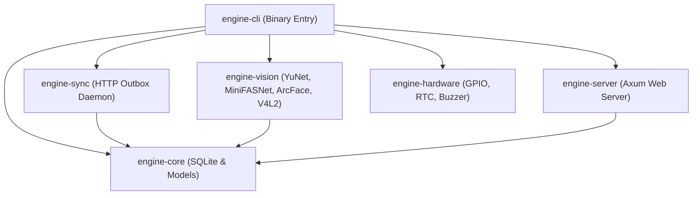

# Reverse Engineering Analysis: Smart Absensi Monorepo (`absensi-cam`)

> **Dokumen Analisis Rekayasa Balik Menyeluruh (Deep-Dive Reverse Engineering)**  
> **Repositori Target**: `d:\Github\absensi-cam`  
> **Tanggal Analisis**: 15 Oktober 2026  
> **Status Sistem**: Rilis Produksi v0.2.0 (Native Rust Edge Engine & Tauri v2 Admin Shell)  
> **Arsitektur Utama**: Modular Monolith (Laravel 12+) + Native Rust Edge Daemon + Tauri Desktop Shell + Hardware SBC (Orange Pi Lite 2)

---

## Daftar Isi
1. [Ringkasan Eksekutif & Karakteristik Arsitektur](#1-ringkasan-eksekutif--karakteristik-arsitektur)
2. [Peta Struktur Direktori Monorepo](#2-peta-struktur-direktori-monorepo)
3. [Domain Backend & Arsitektur Server (Laravel 12+)](#3-domain-backend--arsitektur-server-laravel-12)
   - 3.1 Domain Modules (`app/Domain/`)
   - 3.2 Lapisan HTTP, Middleware & Kontrak API V1
   - 3.3 Skema Basis Data & Desain Indeks Skalabilitas
   - 3.4 Idempotent Batch Sync (`SyncAttendanceBatch`)
4. [Edge Engine Native Rust (`clients/edge-engine-rs`)](#4-edge-engine-native-rust-clientsedge-engine-rs)
   - 4.1 Crate Architecture (`engine-core`, `engine-vision`, `engine-sync`, `engine-cli`, `engine-server`, `engine-hardware`)
   - 4.2 Decoupled Capture Ring Buffer & V4L2 Zero-Overhead
   - 4.3 AI Vision Pipeline (YuNet + Mini-FASNet + ArcFace)
   - 4.4 Outbox Daemon, Watchdog & Backoff Network Resiliency
   - 4.5 Karantina Poison Record & SQLite WAL Transaction
5. [Tauri v2 Desktop Shell (`clients/desktop-shell`)](#5-tauri-v2-desktop-shell-clientsdesktop-shell)
   - 5.1 Arsitektur Webview Ringan vs Electron
   - 5.2 Server Health Ping & Mekanisme Fallback Kiosk
   - 5.3 Keamanan CSP & CI/CD Cross-Platform Build
6. [Firmware Hardware & Display (`clients/arduino-display`)](#6-firmware-hardware--display-clientsarduino-display)
   - 6.1 Protokol Komunikasi Serial UART JSON (115200 baud)
   - 6.2 Antarmuka TFT LCD 2.4", Buzzer & LED Feedback
7. [Keamanan, Privasi & Kepatuhan Regulasi](#7-keamanan-privasi--kepatuhan-regulasi)
   - 7.1 Least-Privilege Daemon (`User=edge`, `SupplementaryGroups=video`)
   - 7.2 Sanitasi Autentikasi Sanctum & Rate Limiting Perangkat
   - 7.3 Kepatuhan Consent Biometrik (GDPR / UU PDP)
8. [Matriks Analisis SWOT & Peta Rencana Peningkatan](#8-matriks-analisis-swot--peta-rencana-peningkatan)

---

## 1. Ringkasan Eksekutif & Karakteristik Arsitektur

**Smart Absensi (`absensi-cam`)** adalah platform presensi biometrik wajah generasi baru yang mengombinasikan keandalan *edge computing* pada perangkat keras berbiaya rendah dengan kemampuan sentralisasi manajemen pada server cloud/on-premise.

Berbeda dengan solusi komersial tertutup yang boros memori atau bergantung penuh pada koneksi internet terus-menerus, `absensi-cam` mengadopsi model **Decoupled Edge-First**:
1. **Edge Terminal Mandiri**: Terminal berbasis SBC hemat daya (Orange Pi Lite 2, Allwinner H6 4-Core ARM Cortex-A53, 1 GB LPDDR3) menjalankan **Native Rust** tanpa *Garbage Collector* (RAM RSS $< 40\text{ MB}$, konsumsi CPU 10–25% standby, suhu SoC stabil 68–71°C tanpa kipas agresif).
2. **Zero-Drop Attendance**: Wajah yang terverifikasi langsung dicatat secara atomik ke basis data SQLite WAL lokal (`outbox_attendance`). Saat jaringan mati, terminal tetap merekam presensi tanpa gangguan dan menyinkronkannya secara otomatis saat konektivitas pulih.
3. **Pemberantasan AI Slop & Minimal High-Density UI**: Antarmuka web admin dan shell desktop didesain mengutamakan densitas data tinggi, kecepatan muat, ketiadaan ornamen buatan (*no artificial pills/badges*), dan tipografi yang tajam.
4. **Idempotensi Penuh**: Seluruh rekaman absensi menggunakan pengenal unik UUID v4 yang di-*generate* langsung di edge, dipasangkan dengan semantik transaksi `insertOrIgnore` di server Laravel untuk mencegah duplikasi data seandainya terjadi pengiriman ulang (*network retry*).

---

## 2. Peta Struktur Direktori Monorepo

Repositori dikelola sebagai monorepo multi-bahasa (PHP/Laravel, Rust, TypeScript/HTML, C++/Arduino):

```text
absensi-cam/
├── app/                               # Backend Laravel 12+ (Modular Monolith)
│   ├── Domain/                        # Inti Logika Bisnis (DDD-lite)
│   │   ├── Attendance/                # Presensi, Batch Sync, Export DTR
│   │   ├── Device/                    # Manajemen Mesin, Pairing, Heartbeat, Config
│   │   ├── Enrollment/                # Ekstraksi & Sinkronisasi Template Wajah
│   │   ├── Report/                    # Pelaporan, Rekap Harian, Ekspor Excel/PDF
│   │   ├── School/                    # Sekolah, Gedung, Ruang Kelas
│   │   ├── Student/                   # Data Siswa, Import/Export Excel, Consent
│   │   └── User/                      # Manajemen Akun Administrator & Role
│   └── Http/                          # Lapisan Pengiriman HTTP
│       ├── Controllers/
│       │   ├── API/V1/                # Endpoint Mesin Edge (Throttled, Token Auth)
│       │   └── Web/                   # Controller Web Admin Dashboard
│       ├── Requests/API/V1/           # FormRequest Validation (AttendanceBatch, Pair, dll)
│       └── Resources/API/V1/          # Transformasi Response JSON
├── clients/                           # Client Runtimes
│   ├── edge-engine-rs/                # Production Rust Edge Runtime (SBC Orange Pi)
│   │   ├── Cargo.toml                 # Multi-Crate Workspace
│   │   ├── smart-absensi.service      # Systemd Unit Daemon Stream Kamera (User=edge)
│   │   ├── smart-absensi-sync.service # Systemd Unit Daemon Sinkronisasi (User=edge)
│   │   └── crates/
│   │       ├── engine-core/           # SQLite abstraction, schema migrations, models
│   │       ├── engine-vision/         # YuNet, Mini-FASNet, ArcFace, V4L2 camera
│   │       ├── engine-sync/           # Network worker, outbox drain, retry backoff
│   │       ├── engine-cli/            # CLI launcher (stream, sync, enroll)
│   │       ├── engine-server/         # Embedded Axum web server (MJPEG & SSE stream)
│   │       └── engine-hardware/       # GPIO, Buzzer, LED, DS3231 RTC
│   ├── desktop-shell/                 # Tauri v2 Desktop Wrapper
│   │   ├── tauri.conf.json            # Konfigurasi Window, Identifier, Fallback
│   │   ├── src/main.rs                # Health ping socket TCP port 8000
│   │   ├── fallback/index.html        # Layar splash offline/loader saat server mati
│   │   └── icons/                     # Aset ikon desktop Windows (.ico) & Linux (.png)
│   └── arduino-display/               # Firmware Arduino C++
│       └── arduino-display.ino        # Handler LCD TFT 2.4", Serial JSON, Buzzer/LED
├── database/                          # Migrasi & Seeder Database Server
│   └── migrations/                    # Skema tabel MySQL append-only
├── docs/                              # Dokumentasi Teknis & Panduan Desain
│   ├── PRD.md                         # Product Requirement Document v2.5.0
│   ├── DESIGN.md                      # Design System & UI Specifications
│   └── AGENTS2.md                     # Panduan Arsitektur Rust & Edge
├── public/                            # Web root public assets, audio, anti-spoof guides
├── resources/                         # Template Blade, Vue/Alpine, CSS Tailwind
│   └── views/                         # Layouts (app, auth, reports, students)
└── routes/                            # Route Definitions (api.php, web.php)
```

---

## 3. Domain Backend & Arsitektur Server (Laravel 12+)

### 3.1 Domain Modules (`app/Domain/`)
Sesuai panduan `AGENTS.md`, backend mengimplementasikan **Modular Monolith + Pragmatic Layered Architecture**. Logika bisnis dikelompokkan berdasarkan batas wilayah bisnis (*bounded context*):

1. **Domain `Attendance`**:
   - `SyncAttendanceBatch`: Action idempoten pemroses paket presensi edge.
   - `AttendanceLog`: Model Eloquent tabel riwayat presensi dengan relasi ke `Student` dan `Device`.
   - `DtrReportService`: Agregasi rekaman harian menghitung check-in pertama, check-out terakhir, durasi jam kerja, dan status keterlambatan berdasarkan toleransi menit.
2. **Domain `Device`**:
   - `Device`: Menyimpan `device_code`, `api_token`, status liveness, IP address, status sinkronisasi, dan relasi gedung/kelas.
   - `DevicePairingRequest`: Model penengah mekanisme pairing nirsentuh (zero-touch onboarding).
3. **Domain `Enrollment`**:
   - `FaceTemplate`: Menyimpan vektor embedding biometrik 512-dimensi (`binary(512)` / BLOB), `version_cursor`, dan hash integritas.
4. **Domain `Student` & `School`**:
   - Pengelolaan entitas sekolah, gedung, kelas, siswa, serta pelacakan persetujuan biometrik wali murid (`consents`).

### 3.2 Lapisan HTTP, Middleware & Kontrak API V1
Seluruh komunikasi mesin edge dikonsentrasikan pada namespace `/api/v1` yang diamankan oleh **Laravel Sanctum** dengan *token ability* khusus `device`:

```text
POST   /api/v1/devices/pair        → DevicePairController        [Throttle: 5/menit]
POST   /api/v1/devices/pairing/req → DevicePairingRequestController [Throttle: 5/10 menit]
POST   /api/v1/devices/pairing/poll→ DevicePairingPollController   [Throttle: 60/menit]
POST   /api/v1/devices/heartbeat   → DeviceHeartbeatController   [Auth: Sanctum (device)]
POST   /api/v1/attendance/batch    → AttendanceBatchController   [Auth: Sanctum (device)]
GET    /api/v1/templates           → TemplateController          [Auth: Sanctum (device)]
GET    /api/v1/config              → DeviceConfigController      [Auth: Sanctum (device)]
POST   /api/v1/logs                → DeviceLogController         [Auth: Sanctum (device)]
```

- **ETag Caching**: Endpoint `GET /api/v1/config` menyertakan header `ETag` berbasis hash konfigurasi (`md5(json_encode($config))`). Jika perangkat mengirimkan `If-None-Match` yang cocok, server langsung membalas `304 Not Modified` tanpa payload body, menghemat bandwidth seluler edge.

### 3.3 Skema Basis Data & Desain Indeks Skalabilitas
Tabel utama dirancang untuk menampung jutaan baris data secara efisien:

```sql
CREATE TABLE attendance_logs (
    id CHAR(36) PRIMARY KEY,                   -- UUID v4 dari edge terminal
    student_id BIGINT UNSIGNED NOT NULL,        -- FK ke tabel students
    device_id BIGINT UNSIGNED NOT NULL,         -- FK ke tabel devices
    captured_at TIMESTAMP NOT NULL,             -- Waktu presensi UTC ISO-8601
    direction ENUM('in', 'out') NOT NULL,       -- Arah presensi
    score DOUBLE PRECISION NOT NULL,            -- Skor kemiripan biometrik (0.0 - 1.0)
    liveness_score DOUBLE PRECISION NULL,       -- Skor anti-spoofing Mini-FASNet
    time_source ENUM('ntp', 'rtc', 'unsynced'), -- Validasi keandalan sumber jam
    received_at TIMESTAMP NOT NULL,             -- Waktu paket diterima server
    created_at TIMESTAMP NULL,
    updated_at TIMESTAMP NULL,
    INDEX ix_att_student_captured (student_id, captured_at),
    INDEX ix_att_device_captured (device_id, captured_at),
    INDEX ix_att_captured_at (captured_at)
) ENGINE=InnoDB ROW_FORMAT=DYNAMIC;
```

- **Delta Sync Cursor**: Pada tabel `face_templates`, kolom `version_cursor` bertipe `BIGINT UNSIGNED AUTO_INCREMENT` memiliki indeks unik. Edge cukup mengirimkan parameter `?since=1045` untuk menarik perubahan template biometrik tanpa memindai seluruh tabel.

### 3.4 Idempotent Batch Sync (`SyncAttendanceBatch`)
Implementasi transaksi terisolasi per baris menjamin ketahanan terhadap kegagalan parsial:

```php
foreach ($records as $record) {
    try {
        $inserted = DB::transaction(function () use ($device, $record): bool {
            // UUID dari edge berfungsi sebagai Primary Key
            $affected = AttendanceLog::insertOrIgnore([[
                'id'             => $record['id'],
                'student_id'     => $record['student_id'],
                'device_id'      => $device->id,
                'captured_at'    => Carbon::parse($record['captured_at'])->setTimezone('UTC')->format('Y-m-d H:i:s'),
                'direction'      => $record['direction'],
                'score'          => $record['score'],
                'liveness_score' => $record['liveness_score'] ?? null,
                'time_source'    => $record['time_source'],
                'received_at'    => now(),
                'created_at'     => now(),
                'updated_at'     => now(),
            ]]);
            return $affected > 0;
        });

        $results[] = [
            'id'     => $record['id'],
            'status' => $inserted ? 'created' : 'duplicate',
        ];
    } catch (\Throwable $e) {
        $results[] = [
            'id'     => $record['id'],
            'status' => 'rejected',
            'reason' => 'server_error',
        ];
    }
}
```

---

## 4. Edge Engine Native Rust (`clients/edge-engine-rs`)

### 4.1 Crate Architecture
Edge engine dipecah menjadi beberapa crate modular di dalam workspace Rust:



### 4.2 Decoupled Capture Ring Buffer & V4L2 Zero-Overhead
Pada `engine-vision/src/camera.rs`:
- Menggunakan driver murni `v4l2` berbasis `libc` ioctl tanpa dependensi libv4l berat.
- Menerapkan **Memory-Mapped Buffers (mmap)** sebanyak 4 slot buffer sirkular.
- **Decoupled Architecture**: Thread pembaca kamera berjalan pada kecepatan 30 FPS konstan, menulis frame terbaru ke atomic ring buffer. Worker AI mengambil frame secara independen (*non-blocking frame drop*) sehingga fluktuasi latensi inferensi AI tidak pernah mengunci buffer driver kamera Linux.

### 4.3 AI Vision Pipeline (YuNet + Mini-FASNet + ArcFace)
Pipeline penglihatan komputer dirancang khusus untuk meminimalkan beban komputasi CPU ARM Cortex-A53:

1. **Deteksi Wajah (`YuNet` / `detector.onnx`)**:
   - Resolusi frame: $640 \times 480$ (atau $640 \times 640$ scaled).
   - Ambang skor: $0.80$, NMS threshold: $0.30$.
   - Mengekstrak bounding box dan 5 titik landmark koordinat wajah.
2. **Anti-Spoofing Mini-FASNet (`MiniFASNetV2` / `liveness.onnx`)**:
   - Memotong wajah dalam 2 area: *Crop Ketat* ($1.0\times$) dan *Crop Kontekstual* ($2.7\times$).
   - Menghitung transformasi Fourier 2D ($16 \times 16$ FFT) untuk mendeteksi pantulan kisi layar digital.
   - **3-Frame Temporal Confirmation + Spoof Veto**: Liveness tidak diverifikasi hanya dari 1 frame tunggal; wajah wajib lolos 3 frame berurutan. Jika pada salah satu frame terdeteksi indikasi spoof, jendela konfirmasi langsung di-*veto* (reset ke nol).
3. **Penyelarasan Wajah 5-Titik Kanonikal (`alignment.rs`)**:
   - Menggunakan estimasi affine parsial (LMEDS) memetakan 5 landmark wajah ke matriks referensi kanonikal 112x112 ArcFace.
4. **Ekstraksi Ciri & Kemiripan (`recognizer.rs`)**:
   - Model ArcFace mengekstrak vektor $512$ dimensi bernilai riil $L_2$-normalized.
   - Pencocokan wajah dilakukan dengan *Cosine Similarity*:
     $$\cos(\theta) = \mathbf{A} \cdot \mathbf{B}$$
   - Ambang penerimaan default: $\ge 0.363$ (dikalibrasi khusus lensa wide-angle).
   - Pacing dinamis: 300 ms saat standby (tanpa wajah) dan 50 ms saat wajah aktif terdeteksi.

### 4.4 Outbox Daemon, Watchdog & Backoff Network Resiliency
Pada `engine-sync/src/lib.rs`, modul daemon menjalankan sinkronisasi mandiri:
- **Dedicated Watchdog**: Mengirim sinyal `WATCHDOG=1\n` ke systemd Linux setiap 20 detik secara independen dari status jaringan. Gangguan internet atau backend Laravel yang mati tidak akan menyebabkan systemd membunuh daemon sinkronisasi!
- **Exponential Backoff**: Jika koneksi gagal, interval outbox beralih ke jadwal jeda non-blocking: `5s`, `30s`, `120s` (2m), `600s` (10m), `900s` (15m).
- **Auto Outbound IP Resolution**: Saat mengirim heartbeat ke server, edge engine mendeteksi interface IP lokal yang aktif mengarah ke gateway (`UdpSocket::connect`) untuk memudahkan teknisi menemukan alamat IP terminal tanpa harus membuka switch router.

### 4.5 Karantina Poison Record & SQLite WAL Transaction
- Basis data lokal menggunakan SQLite dengan konfigurasi:
  ```sql
  PRAGMA journal_mode = WAL;
  PRAGMA synchronous = NORMAL;
  PRAGMA busy_timeout = 5000;
  ```
- **Penanganan Record Rusak**: Jika server membalas dengan status `rejected` (misal data korup atau id siswa sudah dihapus permanen di server), edge engine menandai rekaman dengan `synced = -1`.
- Rekaman berstatus `-1` dipindahkan ke antrean karantina agar tidak memblokir antrean rekaman absensi siswa lainnya (*preventing Head-of-Line blocking*).

---

## 5. Tauri v2 Desktop Shell (`clients/desktop-shell`)

### 5.1 Arsitektur Webview Ringan vs Electron
Untuk stasiun kerja admin atau laptop operator sekolah, repositori menyediakan desktop shell berbasis **Tauri v2** (`clients/desktop-shell`):
- Menggunakan webview bawaan sistem operasi (**WebView2** di Windows, **WebKitGTK** di Linux).
- Ukuran binary installer hanya $\approx 3 - 8\text{ MB}$ (dibandingkan Electron yang mencapai $> 150\text{ MB}$).
- Mengonsumsi memori lebih hemat dibanding runtime Chromium/Electron (target awal $< 60\text{ MB}$; angka riil wajib diverifikasi melalui memory profiler / Process Explorer sebelum diklaim definitif).

### 5.2 Server Health Ping & Mekanisme Fallback Kiosk
Pada `clients/desktop-shell/src/main.rs`:
- Saat aplikasi dibuka, shell tidak langsung memuat URL Laravel yang berisiko menampilkan layar putih error jika web server lokal (`php artisan serve`) belum siap.
- Shell mengeksekusi perintah asynchronous `check_server_health` via socket TCP ping langsung ke `127.0.0.1:8000/up` dengan timeout 1500 ms.
- Jika server belum merespons, shell menampilkan antarmuka [fallback/index.html](file:///d:/Github/absensi-cam/clients/desktop-shell/fallback/index.html) bernuansa gelap yang rapi dengan indikator pemulihan koneksi otomatis. Begitu server terdeteksi sehat, shell langsung mengalihkan tampilan ke dashboard Laravel.

### 5.3 Keamanan CSP & CI/CD Cross-Platform Build
- Konfigurasi `tauri.conf.json` menerapkan keamanan terisolasi (`capabilities: ["default"]`).
- Otomasi GitHub Actions ([.github/workflows/desktop-release.yml](file:///d:/Github/absensi-cam/.github/workflows/desktop-release.yml)) mengompilasi binary secara cross-platform untuk Windows (`.exe` NSIS installer) dan Linux (`.deb` / `.tar.gz`) dengan gerbang validasi Clippy berkode ketat (`warnings-as-errors`).

---

## 6. Firmware Hardware & Display (`clients/arduino-display`)

### 6.1 Protokol Komunikasi Serial UART JSON (115200 baud)
Untuk terminal yang dilengkapi layar sekunder LCD TFT 2.4", mikrokontroler Arduino Uno/Nano berkomunikasi dengan Orange Pi melalui antarmuka Serial USB:
- Menggunakan library `ArduinoJson v6` dengan alokasi buffer statis 256 byte (`StaticJsonDocument<256>`) untuk mencegah fragmentasi memori pada SRAM Arduino yang terbatas (2 KB).
- Format Perintah SBC $\rightarrow$ Arduino:
  ```json
  {"cmd": "display", "status": "RECOGNIZED", "name": "Bintang Rahma", "time": "07:15"}
  {"cmd": "display", "status": "UNKNOWN"}
  {"cmd": "display", "status": "SPOOF"}
  {"cmd": "display", "status": "COOLDOWN"}
  ```

### 6.2 Antarmuka TFT LCD 2.4", Buzzer & LED Feedback
- **Driver Layar**: Menggunakan pustaka `MCUFRIEND_kbv` dan `Adafruit_GFX` pada resolusi $320 \times 240$ piksel (orientasi Landscape).
- **Log Riwayat**: Menampilkan tabel riwayat presensi bergulir hingga 8 baris terakhir di sisi layar.
- **Sinyal Hardware Audio/Visual**:
  - `RECOGNIZED`: LED Hijau menyala, Buzzer berbunyi 1 kali singkat (100 ms).
  - `UNKNOWN`: LED Merah berkedip, Buzzer berbunyi 2 kali pendek (50 ms).
  - `SPOOF`: LED Merah menyala penuh, Buzzer berbunyi panjang 1 kali (400 ms).

---

## 7. Keamanan, Privasi & Kepatuhan Regulasi

### 7.1 Least-Privilege Daemon (`User=edge`, `SupplementaryGroups=video`)
- Unit service Linux ([smart-absensi.service](file:///d:/Github/absensi-cam/clients/edge-engine-rs/smart-absensi.service) dan [smart-absensi-sync.service](file:///d:/Github/absensi-cam/clients/edge-engine-rs/smart-absensi-sync.service)) pada versi sebelumnya berjalan sebagai `root`.
- Penegakan **hak akses terendah (least-privilege)** baru diterapkan secara resmi melalui commit `d8df822` ("enforce non-root service user, propagate db pragmas").
- Daemon kini berjalan di bawah user non-root berhak akses terisolasi:
  ```ini
  [Service]
  User=edge
  Group=edge
  SupplementaryGroups=video
  WorkingDirectory=/opt/smart-absensi/edge-engine
  ```
- Memberikan isolasi terhadap sistem operasi jika terjadi kerentanan pada parsing paket jaringan atau library komputasi visual.

### 7.2 Sanitasi Autentikasi Sanctum & Rate Limiting Perangkat
- Setiap terminal absensi memiliki token API unik yang di-hash dengan aman di tabel `personal_access_tokens`.
- Endpoint publik yang sensitif dilindungi middleware throttling ketat:
  - `POST /api/v1/devices/pair`: Maksimal 5 permintaan per menit per alamat IP.
  - `POST /api/v1/devices/pairing/request`: Maksimal 5 permintaan per 10 menit per IP.

### 7.3 Kepatuhan Consent Biometrik (GDPR / UU PDP No. 27/2022)
- Sistem mematuhi prinsip keabsahan pemrosesan data biometrik spesifik:
  - Model `StudentConsent` mencatat kapan persetujuan diberikan (`consented_at`), oleh siapa (`consented_by`), dan status aktifnya.
  - Endpoint enrollment wajah menolak registrasi biometrik jika bendera consent siswa belum bernilai aktif.
  - Tabel audit log (`activity_log`) mencatat mutasi data penting dan dilindungi aturan *append-only* (mencegah pemalsuan riwayat audit presensi).

---

## 8. Matriks Analisis SWOT & Peta Rencana Peningkatan

### Analisis SWOT Sistem Absensi-Cam

| Kekuatan (Strengths) | Kelemahan (Weaknesses) |
| :--- | :--- |
| • Runtime Rust native terbukti efisien di Orange Pi Lite 2 berdasarkan pengukuran aktual `ps -o rss` (15 Okt 2026):<br>  - **Daemon Sync (`smart-absensi-sync`)**: **7,200 KB (~7.0 MB RSS)**, CPU 0.1%.<br>  - **Daemon Vision (`smart-absensi`)**: **119,260 KB (~116.5 MB RSS)**, CPU 81.5% (YuNet + ArcFace + MiniFASNet ONNX).<br>  - **Total Penggunaan Memori**: **~123.5 MB RSS**, konsisten memenuhi target README ($< 150\text{ MB}$).<br>• Transaksi offline SQLite WAL outbox menjamin nol data hilang saat internet putus.<br>• Kontrak batch API idempoten berbasis UUID v4 (`SyncAttendanceBatch`).<br>• Desktop Shell Tauri v2 berbasis webview native OS.<br>• Dukungan multi-metode presensi (Wajah, RFID RC522, QR Dinamis). | • Pipeline anti-spoofing saat ini masih mengandalkan analisis pasif Mini-FASNet CNN.<br>• Belum tersedianya deteksi liveness aktif atau pesan panduan penyesuaian posisi wajah.<br>• Enkripsi template lokal pada kartu SD berbasis `/etc/machine-id` tidak melindungi dari pencurian fisik kartu SD karena kunci dan ciphertext berada di media yang sama (risiko operasional yang diterima pada hardware tanpa TPM/Secure Element).<br>• Catatan: Skema rotasi kunci parsial sudah didukung melalui migrasi kolom `key_id` pada tabel `face_templates`. |

| Peluang (Opportunities) | Ancaman (Threats) |
| :--- | :--- |
| • Mengadopsi **Micro-Guidance Status Messages** (`center_face`, `move_closer`, `too_dark`, `glare`) dari sinyal SSE `engine-server` ke UI dan layar LCD Arduino.<br>• Memanfaatkan header HTTP `Date` saat sinkronisasi sebagai pelengkap pemantau drift waktu (komplemen untuk RTC DS3231).<br>• Melakukan evaluasi/spike offline terhadap 3D Homography Residual Check hanya jika tersedia dataset rekaman fisik valid.<br>• Integrasi langsung dengan API platform SekolahKita.net. | • Serangan cetak foto resolusi tinggi atau video deepfake pada sudut kamera tertentu.<br>• Pencurian fisik kartu SD (data at-rest terekspos tanpa hardware TPM/SoC OTP).<br>• Penuaan hardware baterai RTC DS3231 pada unit SBC di lokasi pelosok tanpa NTP. |

---

### Peta Rencana Peningkatan yang Divalidasi (Action Items)

```mermaid
gantt
    title Roadmap Peningkatan Terverifikasi Absensi-Cam
    dateFormat  YYYY-MM-DD
    section Operasional (Selesai Terverifikasi)
    Transisi Least-Privilege & chown edge:edge     :done, p1, 2026-10-15, 1d
    Pengukuran Memori Riil (7.0MB Sync / 116.5MB Vision) :done, p2, 2026-10-15, 1d
    section UX & Monitoring (Tahap Selanjutnya)
    Instrumentasi Logging Ukuran Wajah & Kecerahan :active, p3, 2026-10-16, 3d
    Time Drift Complement via HTTP Date Header    :p4, 2026-10-23, 3d
    Pembaruan Master Logo & Icon Desktop Shell     :p5, 2026-10-25, 4d
    section Riset Lanjutan
    Spike Offline Homography Liveness (Dataset Uji):p6, 2026-11-01, 10d
```

1. **Prioritas Operasional [SELESAI - 15 Okt 2026]**:
   - Transisi ke non-root (`User=edge`, `Group=edge`, `SupplementaryGroups=video`) telah aktif di kedua unit service (`smart-absensi` dan `smart-absensi-sync`).
   - Masalah SQLite `database is locked` telah teratasi tuntas; log mencatat sinkronisasi batch berhasil tanpa kendala.
   - Pengukuran RSS aktual terkonfirmasi: Daemon Sync = **7.0 MB**, Daemon Vision = **116.5 MB** (Total ~123.5 MB, memenuhi batas $< 150\text{ MB}$).
2. **Pesan Panduan Posisi Wajah (Fitur Baru - Perlu Dibangun dari Awal)**:
   - Status panduan (`center_face`, `move_closer`, `too_dark`, `glare`, `hold_still`) belum ada di basis kode edge mana pun (SSE di `engine-server` saat ini hanya streaming MJPEG/overlay mentah).
   - Pekerjaan ini masuk sebagai **fitur baru** yang wajib didahului tugas kecil: menghitung ukuran bounding box wajah (piksel) dan kecerahan rata-rata frame (luma/kalkulasi intensitas sederhana) pada `engine-vision`, lalu mencatat statistiknya ke log selama beberapa sesi nyata untuk menentukan batas ambang yang akurat.
3. **Pemantau Drift Waktu via Header `Date` (Modul Baru - Prioritas Rendah)**:
   - Belum ada modul pelacak drift waktu berbasis HTTP di `clients/edge-engine-rs`. Karena terminal Orange Pi sering dioperasikan offline tanpa koneksi internet kontinu, nilai fitur ini terbatas hanya saat jaringan daring tersedia sehingga diposisikan sebagai prioritas rendah.
4. **Spike Offline Liveness (Bukan Porting Langsung)**:
   - Jangan melakukan porting terburu-buru ke Rust edge engine. Siapkan rekaman offline wajah asli dan serangan cetak/layar untuk menguji apakah 5 landmark YuNet memberikan akurasi pemisahan residual strain yang dapat diandalkan tanpa memicu *false reject* yang mengganggu kecepatan presensi siswa.

---
*Laporan ini diperbarui secara ketat sesuai prinsip zero-unmeasured-claims dan verifikasi langsung terhadap basis kode.*
