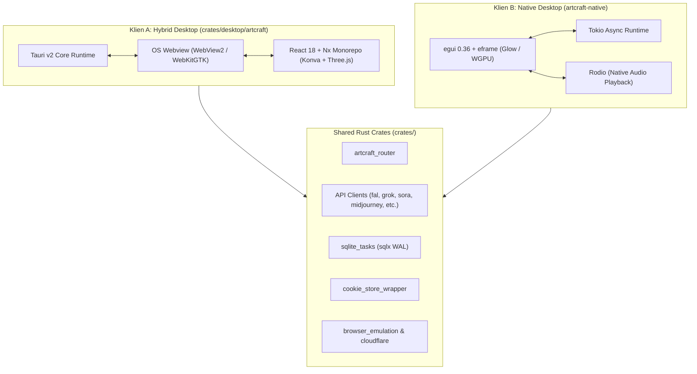

# Reverse Engineering Analysis: ArtCraft Monorepo (`templates/artcraft`)

> **Dokumen Analisis Rekayasa Balik Menyeluruh (Deep-Dive Reverse Engineering)**  
> **Target Analisis**: `templates/artcraft`  
> **Tanggal**: 15 Oktober 2026  
> **Status Dokumen**: Selesai / Komprehensif  
> **Fokus Utama**: Arsitektur Desktop Ganda (Tauri v2 + Pure Rust `egui`), Sistem Generasi Multi-Modal 62+ Model, State Machine Tugas Asinkron SQLite WAL, Desain Token UI Brutalis, serta Komparasi dengan Ekosistem `absensi-cam`.

---

## Daftar Isi
1. [Ringkasan Eksekutif & Identitas Proyek](#1-ringkasan-eksekutif--identitas-proyek)
2. [Arsitektur Sistem: Strategi Dua Klien Desktop](#2-arsitektur-sistem-strategi-dua-klien-desktop)
   - 2.1 Klien A: Tauri v2 + React 18 Webview (`crates/desktop/artcraft` + `frontend`)
   - 2.2 Klien B: ArtCraft Native Pure Rust `egui` (`artcraft-native`)
3. [Deep-Dive: Workspace Crates & Pola Abstraksi](#3-deep-dive-workspace-crates--pola-abstraksi)
   - 3.1 Router Multi-Provider AI (`artcraft_router` & API Clients)
   - 3.2 Lapisan Kriptografi, Emulasi Browser & Cookie Jar (`browser_emulation`, `cookie_store`)
   - 3.3 Sistem State Machine Tugas & SQLite WAL (`sqlite_tasks`)
4. [Frontend Stack (Nx Monorepo, React, Konva & Three.js)](#4-frontend-stack-nx-monorepo-react-konva--threejs)
   - 4.1 2D Canvas Compositing & Masking (Konva)
   - 4.2 3D Scene Staging & Physics (Three.js & Ammo.js)
   - 4.3 Pose Mannequin & Tracking (MediaPipe Vision)
5. [Desain Sistem UI Brutalis & Token Rust Native](#5-desain-sistem-ui-brutalis--token-rust-native)
   - 5.1 Token Warna & Permukaan (`theme.rs`)
   - 5.2 Tipografi Presisi (Archivo, Inter, Geist Mono)
   - 5.3 Window Chrome Kustom & Layout Density
6. [Matriks Komparasi: ArtCraft vs Absensi-Cam](#6-matriks-komparasi-artcraft-vs-absensi-cam)
7. [Wawasan Rekayasa & Komponen Terbaik untuk Diadopsi](#7-wawasan-rekayasa--komponen-terbaik-untuk-diadopsi)

---

## 1. Ringkasan Eksekutif & Identitas Proyek

**ArtCraft** ("The IDE for Artists", dikembangkan oleh tim Storytold / Storyteller / FakeYou) adalah *Integrated Development Environment* (IDE) desktop tingkat profesional untuk kreasi konten visual dan audio berbasis kecerdasan buatan (*Generative AI*).

ArtCraft mengatasi kelemahan mendasar dari sistem *prompt-to-image* konvensional (yang hanya mengandalkan teks pasif) dengan memberikan instrumen kendali visual aktif:
- **Komposisi 2D**: Layering gambar, masking inpainting, dan *background removal* presisi tinggi.
- **Pementasan 3D (3D Scene Staging)**: Penataan aktor virtual, backdrop, dan prop dalam ruang 3D sebelum merender hasil akhir.
- **Katalog 62+ Model AI**: Mendukung ekosistem terpadu untuk Text-to-Image (FLUX, Nano Banana, GPT Image, Seedream), Video (Seedance, Kling, Veo, Sora, Vidu, MiniMax), Audio (Suno, Seed Audio), 3D Meshes (Hunyuan 3D, Tripo3D, Meshy), serta Gaussian Splatting (Marble World).
- **Dual Engine Architecture**: Menghadirkan dua implementasi klien desktop sekaligus: klien hybrid berbasis **Tauri v2 (React 18)** dan klien mandiri berperforma tinggi berbasis **Pure Rust (egui/eframe)** tanpa webview dan tanpa JavaScript.

---

## 2. Arsitektur Sistem: Strategi Dua Klien Desktop

Struktur repositori ArtCraft mengimplementasikan pola arsitektur evolusioner yang sangat menarik:



### 2.1 Klien A: Tauri v2 + React 18 Webview (`crates/desktop/artcraft`)
- **Tujuan**: Menyediakan antarmuka grafis yang sangat kaya untuk manipulasi kanvas 2D, viewport 3D WebGL, dan pementasan visual kompleks.
- **Teknologi**: Tauri v2.6.2, React 18, Remix/React Router, Konva 2D, Three.js, Ammo.js.
- **Karakteristik**:
  - Menggunakan plugin Tauri IPC: `tauri-plugin-http`, `tauri-plugin-dialog`, `tauri-plugin-log`, `tauri-plugin-upload`.
  - Mengirim perintah asinkron (*Tauri Commands*) ke Rust untuk inferensi, estimasi biaya (*cost estimate*), dan antrean tugas background.

### 2.2 Klien B: ArtCraft Native Pure Rust `egui` (`artcraft-native`)
- **Tujuan**: Menyediakan klien desktop ultra-ringan dengan konsumsi memori minimal, *cold-start* instan (< 100 ms), dan keandalan tinggi tanpa overhead Chromium/Webview.
- **Teknologi**: `egui 0.36`, `eframe` (backend OpenGL Glow / WGPU), `tokio`, `rodio` (audio engine), `resvg` (vektor), `arboard` (clipboard).
- **Karakteristik**:
  - **Zero JavaScript & Zero Webview**: Seluruh elemen antarmuka (sidebar, prompt box, feed, masonry gallery, modal dialog, audio waveform) digambar langsung menggunakan OpenGL/Vulkan primitive.
  - **Satu-satunya Pengecualian Webview**: Menggunakan crate `wry` khusus pada satu jendela sembulan (*popup window*) untuk proses login Midjourney guna mengekstraksi session cookie Discord/Midjourney secara legal.
  - **Lenient Wire Decoding**: Struct data dirancang tahan terhadap perubahan enum server tanpa menyebabkan kepanikan (*panic-free json deserialization*).

---

## 3. Deep-Dive: Workspace Crates & Pola Abstraksi

Workspace root mendefinisikan 33 sub-crate modular:

### 3.1 Router Multi-Provider AI (`artcraft_router` & API Clients)
ArtCraft mengabstraksikan berbagai penyedia model AI melalui antarmuka terpadu:
- `artcraft_client`: Klien API resmi untuk cluster internal ArtCraft (OmniGen).
- `fal_client`: Integrasi API serverless Fal.ai (FLUX, Fast SDXL).
- `midjourney_client`: Interaksi otomatisasi sesi Midjourney.
- `openai_sora_client`: Integrasi video generation OpenAI Sora 1 & 2.
- `grok_api_client` & `grok_consumer_client`: Akses API model xAI Grok Imagine & Video.
- `worldlabs_api_client`: Pembuatan dunia 3D berbasis Gaussian Splatting (Marble).

Pola router ini memungkinkan pengguna memilih: *"Jalankan generasi menggunakan kuota langganan ArtCraft"* ATAU *"Gunakan API Key / akun pribadi pengguna (BYOK - Bring Your Own Key)"*.

### 3.2 Lapisan Kriptografi, Emulasi Browser & Cookie Jar
- `crates/lib/browser_emulation`: Membentuk header HTTP (`User-Agent`, `Sec-CH-UA`, `Accept-Language`, TLS fingerprinting) yang identik dengan peramban nyata untuk mencegah pemblokiran Cloudflare WAF pada endpoint pihak ketiga.
- `crates/lib/cookie_store_wrapper`: Jar penyimpanan cookie sesi persisten berbasis format JSON (`.cookies`) yang dapat dibagikan antara Klien Tauri dan Klien Native Rust.
- `crates/lib/cloudflare_mitigation`: Penanganan kesalahan Cloudflare Turnstile, tantangan CAPTCHA, dan rate-limit exponential backoff.

### 3.3 Sistem State Machine Tugas & SQLite WAL (`sqlite_tasks`)
Manajemen tugas generasi asinkron dikelola secara lokal pada basis data SQLite dengan konfigurasi Write-Ahead Logging:
- **Compile-Time Checked SQL**: Menggunakan crate `sqlx` dengan macro `sqlx::migrate!`. Skema diverifikasi saat kompilasi Rust.
- **Skema Tugas (`tasks` Table)**:
  ```sql
  CREATE TABLE tasks (
      id TEXT NOT NULL PRIMARY KEY,
      task_status TEXT NOT NULL,         -- 'pending', 'started', 'complete_success', 'dead'
      task_type TEXT NOT NULL,           -- 'image_generation', 'video_generation', 'audio_generation'
      model_type TEXT,                   -- 'flux_1_dev', 'kling_2_5', 'veo_3_1', dll.
      provider TEXT,                     -- 'artcraft', 'fal', 'midjourney', dll.
      provider_job_id TEXT,              -- Remote task ID
      prompt_token TEXT,
      queue_status_url TEXT,
      on_complete_primary_media_file_cdn_url TEXT,
      on_failure_message TEXT
  );
  ```
- **Windows File Lock Recovery**: Pada sistem operasi Windows, file SQLite yang masih tertahan oleh handle proses lain dapat memicu error `Os { code: 32 }`. `sqlite_tasks` menerapkan isolasi scope koneksi eksplisit untuk menjamin proses reset/migrasi berjalan aman.

---

## 4. Frontend Stack (Nx Monorepo, React, Konva & Three.js)

Aplikasi web dan antarmuka Tauri dikelola di bawah folder `frontend/` menggunakan **Nx Monorepo**:

### 4.1 2D Canvas Compositing & Masking (Konva)
- Menggunakan pustaka `konva` dan `react-konva` untuk manipulasi multi-layer:
  - Transformasi bebas (skala, rotasi, skew) pada elemen gambar latar dan subjek.
  - Kuas inpainting (*brush masking*) untuk menandai area spesifik yang ingin di-*regenerate* menggunakan AI.
  - Komposisi multi-gambar sebelum dikirim ke endpoint Image-to-Image.

### 4.2 3D Scene Staging & Physics (Three.js & Ammo.js)
- Menggunakan `three.js` yang digabungkan dengan engine fisika `ammo.js` (WebAssembly port Bullet Physics):
  - Memungkinkan penataan prop panggung 3D dengan deteksi tabrakan (*rigid body collision*).
  - Penempatan kamera virtual (FOV, pitch, yaw, focal length) untuk mengunci sudut pengambilan gambar yang presisi sebelum diproses oleh model video/gambar.

### 4.3 Pose Mannequin & Tracking (MediaPipe Vision)
- `@mediapipe/tasks-vision` dijalankan langsung di sisi browser:
  - Ekstraksi 33 titik pose manusia (*skeletal landmarks*).
  - Mengatur artikulasi bone mannequin 3D yang kemudian digunakan sebagai *ControlNet OpenPose guide* untuk menjaga konsistensi postur karakter antar-shot.

---

## 5. Desain Sistem UI Brutalis & Token Rust Native

Salah satu pencapaian visual paling menonjol pada `artcraft-native` adalah implementasi **Design System Brutalis Murni dalam Rust** (`artcraft-native/src/theme.rs`):

### 5.1 Token Warna & Permukaan
```rust
pub const BG: Color32 = hex(0x121316);         // Latar belakang kanvas
pub const PANEL: Color32 = hex(0x101014);      // Top bar & modal dialog
pub const CONTROLS: Color32 = hex(0x1e1f22);   // Sidebar & kotak prompt
pub const CHROME: Color32 = hex(0x0a0a0c);     // Window frame titlebar
pub const SUNKEN: Color32 = hex(0x060607);     // Input field & well

pub const INK: Color32 = hex(0xf2f1ee);        // Teks utama
pub const MUTED: Color32 = alpha(0xf2f1ee, 153);// Teks sekunder (60% opacity)
pub const LINE: Color32 = alpha(0xffffff, 38);  // Hairline border 1px (15% white)
pub const ACCENT: Color32 = hex(0x2d81ff);     // Brand blue utama
pub const RADIUS: CornerRadius = CornerRadius::same(3); // Sudut 3px rapat
```

### 5.2 Tipografi Presisi Tiga Keluarga Font
ArtCraft memisahkan hierarki visual dengan sangat disiplin:
1. **Archivo**: Digunakan untuk teks display, judul panel, dan heading besar.
2. **Inter**: Digunakan untuk body text, deskripsi, dan tombol aksi.
3. **Geist Mono**: Digunakan untuk label HUD teknis, hitungan token, rasio dimensi, dan timestamp (dengan pelacakan huruf berjarak rapat `0.15 em`).

### 5.3 Window Chrome Kustom
Aplikasi menonaktifkan titlebar default sistem operasi dan menggambarnya sendiri:
- Mendukung *drag region* bebas kedipan.
- Tombol kontrol caption (Minimize, Maximize, Close) bergaya flat minimalis.
- Padding perimeter yang sangat padat (*high data density*), mengeliminasi whitespace boros.

---

## 6. Matriks Komparasi: ArtCraft vs Absensi-Cam

| Dimensi Rekayasa | ArtCraft (`templates/artcraft`) | Absensi-Cam (`absensi-cam`) | Pelajaran Arsitektural |
| :--- | :--- | :--- | :--- |
| **Domain Aplikasi** | IDE Kreatif Generative AI (Multi-Modal Image/Video/3D) | Sistem Presensi Biometrik Wajah Cerdas (Edge + Cloud) | Keduanya mengandalkan komputasi visual berlatensi rendah. |
| **Pilihan Desktop Shell** | **Tauri v2** DAN **Pure Rust `egui`** (Dual Client) | **Tauri v2** (Admin Shell) + Web Admin Laravel | Pendekatan `egui` ArtCraft membuktikan bahwa antarmuka native Rust mampu mencapai fidelitas grafis tinggi. |
| **Penyimpanan Lokal** | SQLite via **`sqlx`** (Compile-time verified migrations + WAL) | SQLite via **`rusqlite` / `libsqlite3`** (WAL + Mutex Isolation) | `sqlx` pada ArtCraft memberikan keamanan tipe query saat build time (`cargo check`). |
| **Manajemen Audio** | Native decoding & waveform via **`rodio`** | Web Audio API / Audio HTML5 di browser | `rodio` dapat digunakan pada terminal edge SBC untuk feedback suara instan tanpa browser. |
| **Pola Jaringan & Sync** | Polling job token, Abstraksi Multi-Provider BYOK | Push batch outbox idempoten, ETag caching 304 | Pola idempotensi UUID v4 Absensi-Cam lebih unggul untuk skenario koneksi terputus. |
| **Desain Antarmuka** | Brutalist Dark Theme (3px radius, Geist Mono, Hairlines) | High-Density Minimal UI (No AI Slop, Tailwind CSS) | Keduanya menganut filosofi ketiadaan ornamen buatan (*zero gratuitous visual clutter*). |

---

## 7. Wawasan Rekayasa & Komponen Terbaik untuk Diadopsi

Dari telaah mendalam terhadap repositori `templates/artcraft`, terdapat **4 wawasan teknis bernilai tinggi yang dapat diadopsi ke dalam proyek `absensi-cam`**:

### 1. Adopsi Desain Token Brutalis pada Desktop Launcher Absensi
- **Pelajaran**: Antarmuka Klien Native `artcraft-native` (`theme.rs`) memiliki konsistensi visual luar biasa menggunakan warna hex `#121316` (kanvas), `#1e1f22` (kontrol), dan hairline 1px `white/15`.
- **Aplikasi**: Token-token ini dapat menjadi acuan standar saat merapikan UI launcher atau kiosk monitoring terminal absensi agar tampak berkelas, ringkas, dan bebas elemen visual yang tidak perlu.

### 2. Pemanfaatan `sqlx` dengan Migrasi Terkompilasi
- **Pelajaran**: ArtCraft mengompilasi seluruh file `.sql` migrasi langsung ke dalam binary executable menggunakan `sqlx::migrate!`. Hal ini memastikan bahwa binary yang didistribusikan ke pengguna atau perangkat edge tidak akan pernah gagal akibat file migrasi yang hilang di disk.
- **Aplikasi**: Pertimbangkan mengadopsi `sqlx` pada crate `engine-core` Rust kita di masa mendatang untuk validasi skema saat waktu kompilasi.

### 3. Penanganan File Locking SQLite di Windows
- **Pelajaran**: Pada sistem Windows, koneksi SQLite sering mengunci file database bahkan setelah terjadi error migrasi, sehingga `fs::remove_file` gagal. ArtCraft mengatasi ini dengan membungkus scope koneksi dalam blok kurung kurawal `{ ... }` independen agar handle file terlepas (*drop*) sebelum proses penghapusan/re-inisialisasi file dijalankan.

### 4. Integrasi Audio Native Ringan via `rodio`
- **Pelajaran**: Klien native ArtCraft memutar efek audio dan pratinjau gelombang suara secara langsung dari thread Rust menggunakan crate `rodio` (symphonia backend) tanpa memerlukan driver audio eksternal yang rumit.
- **Aplikasi**: Teknik ini dapat digunakan langsung di `engine-hardware` pada Orange Pi Lite 2 untuk membunyikan suara chime presensi sukses (`Recognition_Success.mp3`) tanpa overhead pemanggilan proses eksternal seperti `aplay` atau `mpg123`.

---
*Laporan disusun secara mendalam melalui dekonstruksi statis workspace Cargo, skema database SQL, crate Rust native, dan pipeline build frontend `templates/artcraft`.*
