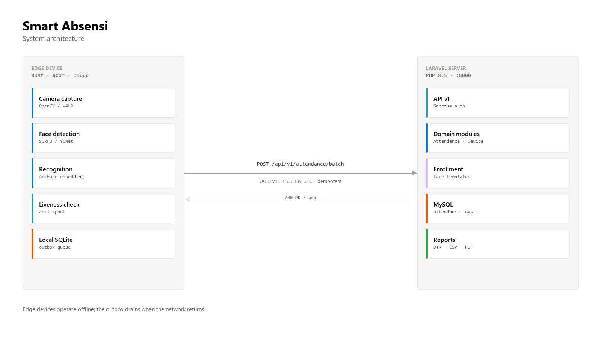
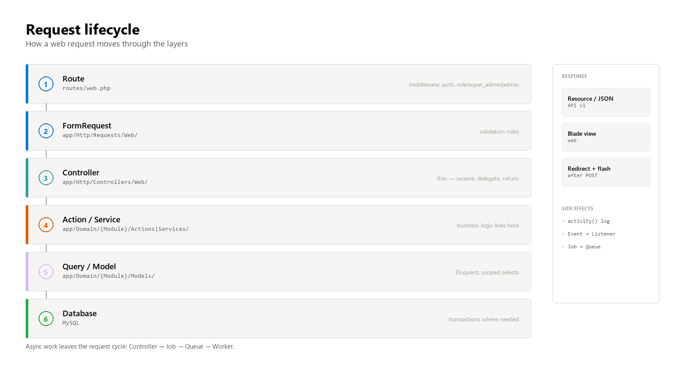
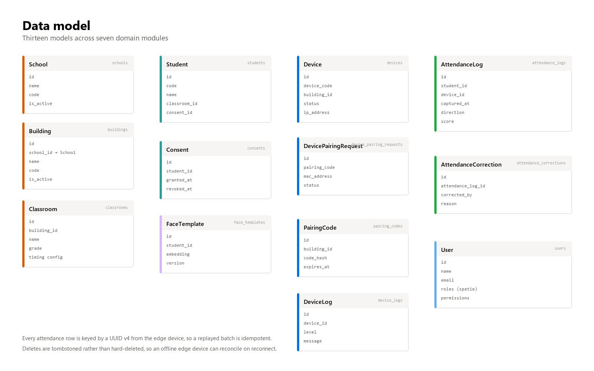
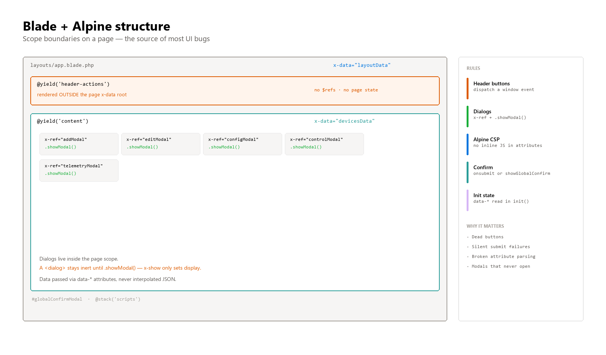

# Smart Absensi documentation

A school attendance system built around face recognition at the door. Edge devices capture and match
faces offline; a Laravel server aggregates the records and produces reports.

This file is the entry point. It explains what the system does, how it is put together, and how to
work on it without breaking things.

---

## Contents

1. [What the system does](#1-what-the-system-does)
2. [Repositories and components](#2-repositories-and-components)
3. [Architecture](#3-architecture)
4. [Data model](#4-data-model)
5. [Routes and access control](#5-routes-and-access-control)
6. [Backend conventions](#6-backend-conventions)
7. [Frontend conventions](#7-frontend-conventions)
8. [Edge engine](#8-edge-engine)
9. [Local development](#9-local-development)
10. [Testing](#10-testing)
11. [Known failure modes](#11-known-failure-modes)
12. [Document index](#12-document-index)

---

## 1. What the system does

A student walks up to the camera at a school gate. The edge device detects a face, checks liveness,
and compares the embedding against the templates it holds locally. On a match it writes an attendance
record to a local SQLite outbox and shows the student's name on the display.

The outbox drains to the server over HTTPS whenever the network is available. A school with
unreliable internet still records attendance; the records simply arrive later.

The server turns those records into daily time records (DTR), CSV exports, and PDF reports.

**Design constraints that shaped everything else:**

- The edge device must work with no network at all.
- The edge device runs on constrained ARM hardware (Orange Pi Lite 2) with no fan.
- Biometric data is sensitive, so templates are encrypted at rest and never leave the device
  unencrypted.
- The same batch may be sent twice, so ingestion must be idempotent.

---

## 2. Repositories and components

| Path | What it is |
|---|---|
| `app/` | Laravel application |
| `resources/` | Blade views, CSS, JavaScript |
| `routes/` | Web and API route definitions |
| `models/` | Tracked ONNX models (detector, recognizer, liveness) |
| `clients/edge-engine-rs/` | **Production edge runtime & server face-extract** — Rust, axum |
| `clients/edge-engine/` | Python reference implementation (tooling only) |
| `packages/face_core/` | (Deprecated) Python face pipeline used for benchmarking |
| `archive/edge-engine-py/` | Legacy — do not add features here |
| `templates/artcraft/` | Design reference for the edge control panel |
| `docs/` | This documentation |

The Rust engine is the only runtime in production (edge device sync/streamer and server `face-extract` CLI). The Python components exist for offline benchmarking and research reference.


---

## 3. Architecture

**Modular monolith with pragmatic layering.** The rules in `AGENTS.md` §1.1 are explicit: do not
introduce Clean Architecture, Hexagonal, CQRS, or Event Sourcing.



### Request flow

Every web request follows the same path.



```
Route → FormRequest → Controller → Action/Service → Query/Model → Database → Resource/Response
```

Controllers stay thin. They receive a request, validate it through a FormRequest, call an Action or
Service, and return a response. Business logic does not live in controllers, and complex queries do
not either.

### Domain modules

Code is organised by business module under `app/Domain/{Module}/`. Each module contains only the
subfolders it actually needs — `Models/`, `Actions/`, `Services/`, `Queries/`, `DTOs/`.

| Module | Responsibility |
|---|---|
| `Attendance` | `AttendanceLog`, `AttendanceCorrection`, `SyncAttendanceBatch` |
| `Device` | `Device`, `DeviceLog`, `DevicePairingRequest`, `PairingCode`, pairing actions |
| `Enrollment` | `FaceTemplate`, `EnrollFace`, `FaceEncryptionService`, `BiometricDuplicateDetector` |
| `Report` | `DtrService`, `DtrExport` |
| `School` | `School`, `Building`, `Classroom` |
| `Student` | `Student`, `Consent`, `StudentsImport`, `StudentsTemplateExport` |
| `User` | `User`, `UserData` DTO, `UserSearchQuery`, `CreateUser` |

When working on a feature, stay inside its module. Do not scatter logic across `app/Services/` or
`app/Helpers/` unless the code is genuinely shared infrastructure.

---

## 4. Data model

Thirteen models across seven modules, backed by 21 migrations.



Two properties matter more than the rest:

**Idempotent ingestion.** Every attendance record carries a UUID v4 generated on the edge device.
The server uses `insertOrIgnore` semantics, so replaying a batch is safe. This is what allows the
outbox to retry aggressively without creating duplicates.

**Tombstones instead of hard deletes.** When a student is removed, the record is marked rather than
destroyed, so an edge device that has been offline for a week can reconcile correctly on reconnect.

---

## 5. Routes and access control

### Web routes

Defined in `routes/web.php`.

| Path | Access |
|---|---|
| `/` | public — landing page |
| `/login` | public, throttled to 5 attempts per minute |
| `/dashboard`, `/live-camera` | any authenticated user |
| `/reports/*` | view: any authenticated user · export and correction: `role:super_admin\|admin` |
| `/students` (index, show) | any authenticated user |
| `/students/*` (create, update, delete, enroll, import) | `role:super_admin\|admin` |
| `/devices/*` | `role:super_admin\|admin` |
| `/schools/*` | `role:super_admin\|admin` |

### API routes

Defined in `routes/api.php`, versioned under `/api/v1`.

| Endpoint | Auth |
|---|---|
| `GET /api/health` | public |
| `POST /api/v1/devices/pair` | public, throttled 5/min |
| `POST /api/v1/devices/pairing/request` | public, throttled 5/10min |
| `POST /api/v1/devices/pairing/poll` | public, throttled 60/min |
| `POST /api/v1/devices/heartbeat` | Sanctum, `ability:device` |
| `POST /api/v1/attendance/batch` | Sanctum, `ability:device` |
| `GET /api/v1/templates` | Sanctum, `ability:device` |
| `GET /api/v1/config` | Sanctum, `ability:device` |
| `POST /api/v1/logs` | Sanctum, `ability:device` |

### Authorization rules

Authorization happens server-side, always. Never trust a hidden button, a frontend role, or a request
parameter.

Roles come from `spatie/laravel-permission`. Prefer capability checks (`$user->can('device.update')`)
over hardcoded role comparisons, per `AGENTS.md` §28.

**The trap that catches everyone:** `/devices` requires `role:super_admin|admin`. A logged-in user
without that role gets a **403**, not a broken page. When writing a test, assign the role first:

```php
Role::firstOrCreate(['name' => 'super_admin', 'guard_name' => 'web']);
$user->assignRole('super_admin');
```

---

## 6. Backend conventions

### Controllers

Thin. Validate through a FormRequest, delegate to an Action or Service, return a response.

```php
public function store(StoreDeviceRequest $request)
{
    $device = $this->createDevice->execute($request->validated());

    return back()->with('success', "Perangkat {$device->name} berhasil ditambahkan.");
}
```

### Actions and services

One public `execute()` method. Business rules live here, including transactions and audit logging.

### Queries

Complex or reused read logic belongs in a Query class, not in a controller or a model scope.

### Models

Explicit `$fillable`. Scoped selects in controllers (`select(['id', 'name', ...])`) rather than
`SELECT *`. Eager-load relationships to avoid N+1.

### Audit logging

Mutations that matter get an activity log entry:

```php
activity('device')
    ->performedOn($device)
    ->causedBy(auth()->user())
    ->log('Device created and token generated');
```

### Validation

FormRequests for anything non-trivial. Inline `$request->validate()` is acceptable for small
controllers but should not grow.

---

## 7. Frontend conventions

The frontend is Blade plus Alpine.js, using the **CSP build** of Alpine. That last detail drives most
of the constraints below.

### Scope boundaries

The layout renders `@section('header-actions')` in the header, which sits **outside** the page's
`x-data` root. This single fact explains most UI bugs in this codebase.



Header buttons cannot reach page state or page `$refs`. Dispatch a window event instead:

```blade
@section('header-actions')
    <button onclick="window.dispatchEvent(new CustomEvent('open-add-device'))">Tambah</button>
@endsection

@section('content')
<div x-data="devicesData" @open-add-device.window="openAdd()">
```

### Dialogs

A `<dialog>` element is inert until `.showModal()` is called. `x-show` only toggles `display`, so a
dialog bound with `x-show` **never opens**. Always use `x-ref` plus `.showModal()`:

```blade
<dialog x-ref="editModal" @close="closeEdit()"
        @click="$event.target === $refs.editModal && closeEdit()">
```

```js
openEdit() { this.$refs.editModal?.showModal(); },
closeEdit() { if (this.$refs.editModal?.open) this.$refs.editModal.close(); },
```

### The CSP build forbids inline JavaScript

`@alpinejs/csp` rejects inline expressions. The practical consequences:

- Never interpolate JSON into an attribute. `@click="openEdit({{ $device->toJson() }})` breaks HTML
  attribute parsing and violates the CSP. Pass the data separately and read it back:

  ```blade
  <button data-device="{{ json_encode($device) }}" @click="openEdit">
  ```

  ```js
  openEdit(e) { const device = JSON.parse(e.currentTarget.dataset.device); }
  ```

- `x-show`, `x-text` and `x-model` accept simple property paths only.
- No arrow functions or object literals inside directives.

### Confirmation dialogs

Two approaches, both acceptable:

- **Native** — `onsubmit="return confirm('...')"`. No scope dependency, simplest option.
- **Global modal** — `confirmSubmit(e)` calls `window.showGlobalConfirm(message, callback)`, backed by
  `#globalConfirmModal` in the layout.

### Alpine components

`layoutData`, `schoolsData`, `reportsData`, `devicesData`, `cameraFeedData`, `membersData` — all in
`resources/js/app.js`. Initial state arrives through `data-*` attributes on the root element and is
read in `init()`, not through inline JavaScript arguments.

### Styling

Tokens live in the `@theme` block of `resources/css/app.css` and match `docs/DESIGN.md`.

| Token | Value |
|---|---|
| `primary` | `#0075de` |
| `canvas` | `#ffffff` |
| `canvas-soft` | `#f6f5f4` |
| `ink` | `#000000` |
| `ink-muted` | `#615d59` |
| `hairline` | `#e6e6e6` |
| `danger` | `#d92d20` |
| `success` | `#1aae39` |
| `warning` | `#dd5b00` |

Component classes: `.btn`, `.badge`, `.alert`, `.card`, `.form-input`, `.data-table`, `.stat-tile`,
`.modal-head` / `.modal-body` / `.modal-foot`, `.empty-state`, `.nav-item`.

`AGENTS.md` rule 6 applies: no decorative badges or pills, compact and dense sizing.

`reports/dtr_pdf.blade.php` uses inline styles deliberately — DomPDF cannot read an external
stylesheet. Leave them inline.

---

## 8. Edge engine

The production runtime is Rust with axum, at `clients/edge-engine-rs/`.

```
src/
  main.rs          entry point, wiring
  core/            db (libsql), storage, models
  vision/          camera, detector, recognizer, liveness, alignment, overlay
  sync/            outbox drain and batch upload
  hardware/        gpio, rfid, arduino, display, tft_streamer
  server/          mod.rs (FrameHub), auth.rs, control.rs, ui.html
```

### Control panel

`/control` serves an admin UI on port 5000. It returns HTML with no `X-Frame-Options` and no CSP, so
it can be embedded in an iframe from the Laravel devices page.

`/api/control/health` is unauthenticated and returns liveness only. Every other endpoint needs a
session cookie.

The iframe is cross-origin, so the edge session cookie does not travel. Expect a 401 on telemetry
unless you have logged into `/control` in the same browser.

### Guidelines

`docs/AGENTS2.md` covers the Rust and Python edge rules in detail — thermal pacing, anti-spoofing,
cross-compilation, read-only rootfs, flash wear.

---

## 9. Local development

### Requirements

PHP 8.5, Composer, Node.js, and (for the edge engine) a Rust toolchain.

### Setup

```bash
composer install
npm install
cp .env.example .env
php artisan key:generate
php artisan migrate --seed
```

### Running

```bash
npm run dev        # Laravel + Vite + queue worker + scheduler
npm run dev:lan    # same, but Laravel binds 0.0.0.0 for device testing
```

On Windows, `dev-start.bat` runs `dev:lan`.

### Asset serving

`public/hot` points at the Vite dev server. While `npm run dev` is running, assets are served from
`http://[::1]:5173` and **`public/build` is ignored**. If a change does not appear, restart Vite
rather than rebuilding.

### Environment keys worth knowing

| Key | Purpose |
|---|---|
| `FACE_EXTRACT_BIN` | Path to the server face-extract binary (see [docs/SERVER_FACE_EXTRACT.md](SERVER_FACE_EXTRACT.md)) |
| `FACE_MODELS_DIR` | Path to directory containing detector and recognizer ONNX models |
| `ORT_DYLIB_PATH` | Path to libonnxruntime dynamic library |
| `ENROLLMENT_EMBED_KEY` | Encryption key for face templates — **rotate if ever exposed** |
| `PAIRING_ALLOW_HTTP` | Permits pairing over plain HTTP for local device testing |
| `ATTENDANCE_RETENTION_DAYS` | Retention window before records are pruned |

### Database

```bash
php artisan migrate:fresh --seed   # destructive, local only
```

Seeders: `DatabaseSeeder`, `RoleSeeder`, `SchoolSeeder`.

---

## 10. Testing

```bash
php artisan test                                   # full suite
php artisan test tests/Feature/DeviceWebCrudTest.php
php artisan test --filter=DeviceCrud
php artisan view:cache                             # catch Blade syntax errors
node --check resources/js/app.js                   # catch JS syntax errors
```

For the edge engine:

```bash
cd clients/edge-engine-rs
cargo check
cargo test --lib
```

### Conventions

`RefreshDatabase` on feature tests. `UserFactory` exists; most other models are created with
`::create()`. Roles via `Role::firstOrCreate`.

### Known pre-existing failure

`MigrationTest > migration maps old columns and types correctly` expects `null` but receives `0` from
`late_tolerance_minutes`. Unrelated to recent work.

---

## 11. Known failure modes

| Symptom | Cause |
|---|---|
| Modal never opens | `<dialog x-show>` — needs `x-ref` and `.showModal()` |
| Header button does nothing | Rendered outside the page's `x-data` root |
| Delete form silently does nothing | `@submit="confirmSubmit"` where the method is out of scope |
| 403 on `/devices` | Missing `role:super_admin\|admin` |
| Edit button throws | JSON interpolated into an Alpine attribute |
| Changes do not appear | Vite dev server serving a stale bundle — restart `npm run dev` |
| `php artisan tinker` fails | PsySH cannot write its history file in some sandboxes; use a bootstrap script |
| Edge returns 401 in the iframe | Cross-origin session cookie does not travel |

---

## 12. Document index

| Document | Covers |
|---|---|
| [PRD.md](PRD.md) | Product requirements, hardware BOM, pinout, power budget, milestones |
| [AGENTS2.md](AGENTS2.md) | Edge engine engineering rules — Rust and Python |
| [DESIGN.md](DESIGN.md) | Design tokens, typography, colour, spacing |
| [TFT_STREAM_PLAN_V3.md](TFT_STREAM_PLAN_V3.md) | TFT display protocol from Orange Pi to Arduino |
| [commercial_models_plan.md](commercial_models_plan.md) | ONNX model licensing and commercial compliance |
| [../AGENTS.md](../AGENTS.md) | Laravel engineering rules — the mandatory guideline |
| [../SECURITY.md](../SECURITY.md) | Security policy |

---

## Before changing anything

1. Read `routes/web.php` — know the middleware and the controller involved.
2. Read the controller and the Action it delegates to.
3. Find a working page of the same kind and diff the broken one against it.
4. Check `AGENTS.md` §118–121 (agent behaviour) and §138 (golden rules).
5. Change one thing, then run the tests.
